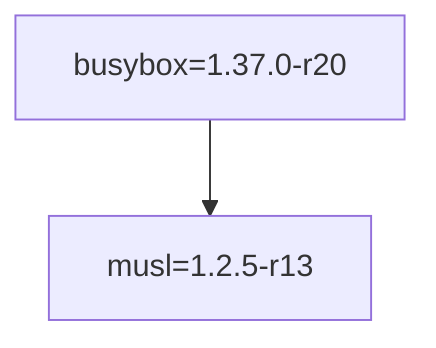
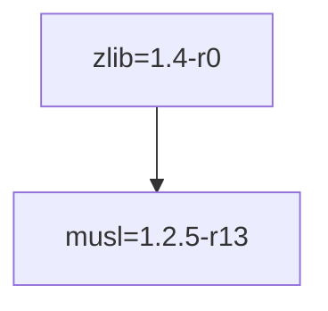
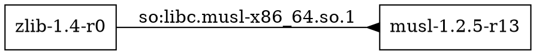
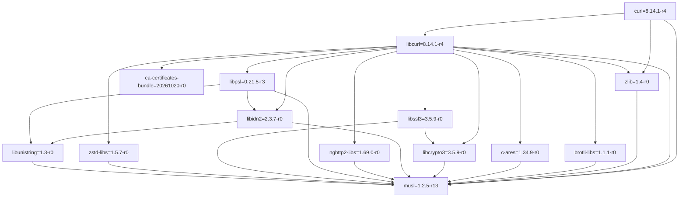
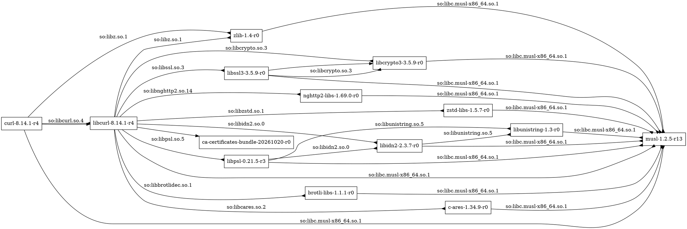

# Этап 5. Сравнение визуализации с apk dot

Проверено 20.11.2026: Alpine v3.22/main, x86_64, apk-tools 2.14.13.
Анализатор и штатный `apk dot` использовали один официальный снимок
APKINDEX. В апплете DOT использованы имена пакетов; в данном снимке
для каждого из трёх корневых имён существовала ровно одна версия.

Источник:
https://dl-cdn.alpinelinux.org/alpine/v3.22/main/x86_64/APKINDEX.tar.gz

SHA-256: `c821afcc97b6e06f7c581a09d40ee361138fdf8708e343a7db6a6fa3ee649726`.

Штатный apk запускался отдельно, в пустом временном root, без установки
пакетов. Локальное зеркало содержало только официальный индекс; из-за
отсутствия доверенных ключей во временном root допускался этот индекс.
Код анализатора не вызывает apk и не зависит от Graphviz.

Команды эталона (root и mirror — абсолютные пути к временным каталогам;
снимок находится в `$mirror/x86_64/APKINDEX.tar.gz`):

```sh
apk --root "$root" --arch x86_64 -X "$mirror" --allow-untrusted \
  --initdb --no-scripts add
for name in busybox zlib curl; do
  apk --root "$root" --arch x86_64 -X "$mirror" --allow-untrusted \
    dot "$name" > "$name.dot"
  dot -Tsvg "$name.dot" -o "$name.svg"
done
```

Сопоставлены идентификаторы пакетов с версиями и направленные рёбра
«пакет → зависимость». Для нашего графа использована глубина 30;
граница не отсекла зависимости. В DOT метки библиотек не принимались
за вершины. Кратные рёбра между одной парой сводились в одно.

| Пакет | Вершины | Рёбра без повторов | Строки рёбер в apk dot |
| --- | ---: | ---: | ---: |
| `busybox=1.37.0-r20` | 2 | 1 | 1 |
| `zlib=1.4-r0` | 2 | 1 | 1 |
| `curl=8.14.1-r4` | 14 | 28 | 30 |

После нормализации все наборы вершин и рёбер совпали. Для curl штатный
инструмент показывает по два ребра для пар curl → libcurl и
libssl3 → libcrypto3: одна связь задана именем пакета, другая через
предоставляемую библиотеку (so:). Mermaid показывает каждого поставщика
один раз на пару, поскольку ребро означает зависимость между пакетами.
DOT также подписывает зависимости от библиотек, а наш вывод показывает
имя и версию разрешённого пакета. Это отличие представления, а не состава
зависимостей. При обновлении индекса версии в новом опыте могут измениться.

Повторить онлайн-демонстрацию: `python examples/demo_stage5.py --online`.
Встроенные диаграммы ниже отображаются при просмотре этого файла на GitHub.

## busybox=1.37.0-r20



<details>
<summary>ASCII-дерево</summary>

```text
busybox=1.37.0-r20
`-- musl=1.2.5-r13
```

</details>

<details>
<summary>Вывод штатного apk dot</summary>


</details>

## zlib=1.4-r0



<details>
<summary>ASCII-дерево</summary>

```text
zlib=1.4-r0
`-- musl=1.2.5-r13
```

</details>

<details>
<summary>Вывод штатного apk dot</summary>



</details>

## curl=8.14.1-r4



<details>
<summary>ASCII-дерево</summary>

```text
curl=8.14.1-r4
|-- libcurl=8.14.1-r4
|   |-- ca-certificates-bundle=20261020-r0
|   |-- brotli-libs=1.1.1-r0
|   |   `-- musl=1.2.5-r13
|   |-- musl=1.2.5-r13 [shared]
|   |-- c-ares=1.34.9-r0
|   |   `-- musl=1.2.5-r13 [shared]
|   |-- libcrypto3=3.5.9-r0
|   |   `-- musl=1.2.5-r13 [shared]
|   |-- libidn2=2.3.7-r0
|   |   |-- musl=1.2.5-r13 [shared]
|   |   `-- libunistring=1.3-r0
|   |       `-- musl=1.2.5-r13 [shared]
|   |-- nghttp2-libs=1.69.0-r0
|   |   `-- musl=1.2.5-r13 [shared]
|   |-- libpsl=0.21.5-r3
|   |   |-- musl=1.2.5-r13 [shared]
|   |   |-- libidn2=2.3.7-r0 [shared]
|   |   `-- libunistring=1.3-r0 [shared]
|   |-- libssl3=3.5.9-r0
|   |   |-- libcrypto3=3.5.9-r0 [shared]
|   |   `-- musl=1.2.5-r13 [shared]
|   |-- zlib=1.4-r0
|   |   `-- musl=1.2.5-r13 [shared]
|   `-- zstd-libs=1.5.7-r0
|       `-- musl=1.2.5-r13 [shared]
|-- musl=1.2.5-r13 [shared]
`-- zlib=1.4-r0 [shared]
```

</details>

<details>
<summary>Вывод штатного apk dot</summary>



</details>
